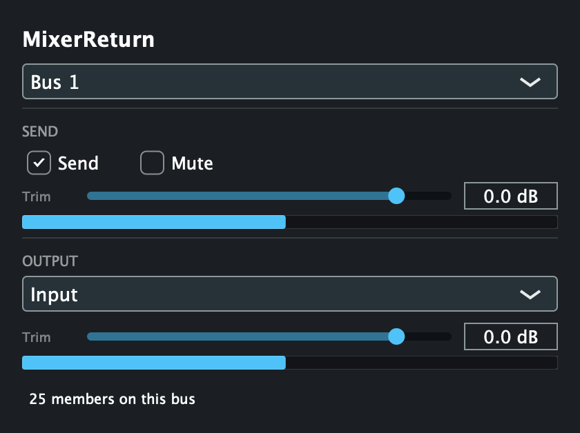
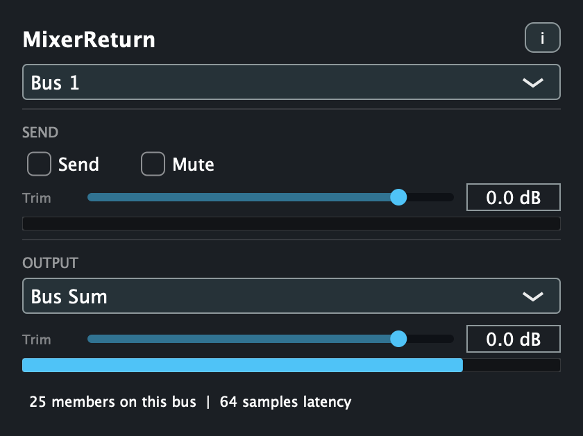

# MixerReturn

> **AI-assisted project.** This codebase was created with [Claude](https://claude.com/claude-code)
> (Anthropic), directed and reviewed by a human author. The summing bus is verified numerically
> against the shipped processor class (`mrtest`): a one-block delay with the summing instance
> processed both first and last, 400 blocks with 17 instances racing on their own threads, and
> trim, mute, bypass participation and bus isolation. `pluginval` passes clean at strictness 8
> on VST3, and on AU with one known benign wrapper warning. It **has** been run with real audio
> in Waves SuperRack Performer on macOS, over a loopback virtual device. It **hasn't** been run
> against a real console or used on a show, and every claim about SQ behaviour comes from the
> reference guide, not from hardware. Check it over before you use it on live gear. The full
> rundown is in the Status section below.

A plugin that bolts a Dugan Automixer onto a console that hasn't got one. It runs post-fader,
and it doesn't cost you an insert slot or a second channel strip per mic.

<!-- downloads:start -->

## Download

**[v0.4.2](https://github.com/stoatworks-labs/mixerreturn/releases/tag/v0.4.2)** — prebuilt for macOS, Windows and Linux. Pick your platform:

<details>
<summary><b>macOS</b> — Universal (Apple Silicon + Intel)</summary>

| Build | Download | Size |
| --- | --- | --- |
| Universal (Apple Silicon + Intel) · .dmg disk image | [`mixerreturn-0.4.2-macos-universal.dmg`](https://github.com/stoatworks-labs/mixerreturn/releases/download/v0.4.2/mixerreturn-0.4.2-macos-universal.dmg) | 9.8 MB |
| Universal (Apple Silicon + Intel) · .pkg installer | [`mixerreturn-0.4.2-macos-universal.pkg`](https://github.com/stoatworks-labs/mixerreturn/releases/download/v0.4.2/mixerreturn-0.4.2-macos-universal.pkg) | 9.8 MB |
| Universal (Apple Silicon + Intel) · .zip archive | [`mixerreturn-macos-universal.zip`](https://github.com/stoatworks-labs/mixerreturn/releases/latest/download/mixerreturn-macos-universal.zip) | 9.8 MB |

</details>

<details>
<summary><b>Windows</b> — x64, ARM64</summary>

| Build | Download | Size |
| --- | --- | --- |
| x64 · .exe installer | [`mixerreturn-0.4.2-windows-x86_64-setup.exe`](https://github.com/stoatworks-labs/mixerreturn/releases/download/v0.4.2/mixerreturn-0.4.2-windows-x86_64-setup.exe) | 2.8 MB |
| ARM64 · .exe installer | [`mixerreturn-0.4.2-windows-aarch64-setup.exe`](https://github.com/stoatworks-labs/mixerreturn/releases/download/v0.4.2/mixerreturn-0.4.2-windows-aarch64-setup.exe) | 2.6 MB |
| x64 · .zip archive | [`mixerreturn-windows-x86_64.zip`](https://github.com/stoatworks-labs/mixerreturn/releases/latest/download/mixerreturn-windows-x86_64.zip) | 5.1 MB |
| ARM64 · .zip archive | [`mixerreturn-windows-aarch64.zip`](https://github.com/stoatworks-labs/mixerreturn/releases/latest/download/mixerreturn-windows-aarch64.zip) | 4.9 MB |

</details>

<details>
<summary><b>Linux</b> — x64, ARM64</summary>

| Build | Download | Size |
| --- | --- | --- |
| x64 · .deb package (Debian/Ubuntu) | [`mixerreturn_0.4.2_amd64.deb`](https://github.com/stoatworks-labs/mixerreturn/releases/download/v0.4.2/mixerreturn_0.4.2_amd64.deb) | 2.1 MB |
| ARM64 · .deb package (Debian/Ubuntu) | [`mixerreturn_0.4.2_arm64.deb`](https://github.com/stoatworks-labs/mixerreturn/releases/download/v0.4.2/mixerreturn_0.4.2_arm64.deb) | 2.2 MB |
| x64 · .rpm package (Fedora/RHEL) | [`mixerreturn-0.4.2-1.x86_64.rpm`](https://github.com/stoatworks-labs/mixerreturn/releases/download/v0.4.2/mixerreturn-0.4.2-1.x86_64.rpm) | 2.2 MB |
| ARM64 · .rpm package (Fedora/RHEL) | [`mixerreturn-0.4.2-1.aarch64.rpm`](https://github.com/stoatworks-labs/mixerreturn/releases/download/v0.4.2/mixerreturn-0.4.2-1.aarch64.rpm) | 2.2 MB |
| x64 · .zip archive | [`mixerreturn-linux-x86_64.zip`](https://github.com/stoatworks-labs/mixerreturn/releases/latest/download/mixerreturn-linux-x86_64.zip) | 4.2 MB |
| ARM64 · .zip archive | [`mixerreturn-linux-aarch64.zip`](https://github.com/stoatworks-labs/mixerreturn/releases/latest/download/mixerreturn-linux-aarch64.zip) | 4.2 MB |

</details>

All builds, checksums and release notes: [github.com/stoatworks-labs/mixerreturn/releases](https://github.com/stoatworks-labs/mixerreturn/releases).

macOS builds are signed and notarised and open normally. The Windows builds are unsigned, so SmartScreen warns once.

<!-- downloads:end -->

## What it's for

MixerReturn is an interface for **Waves SuperRack Performer**. It lets the Dugan Automixer run
across a console's channel **direct outs**, and returns the automixed result summed down to a
**single stereo pair**, which comes back into a **group's External Input**.

The point is what it *doesn't* cost you. Because the automixer works on the direct outs and not
on the channel inserts:

- **The insert slots stay free.** You can still put plugins on the channel strips as normal, and
  the automixer isn't competing for them.
- **The automixer sits post-fader**, without moving any insert points.
- **No channel is used twice.** One channel strip per mic, as usual.

| A channel instance | The return instance |
| --- | --- |
|  |  |

*Both rendered from the actual editor by `mrshot`, with a full 24-channel rig registered on the
bus, so the member count and the latency readout are the real values rather than a mock-up.*

MixerReturn is a VST3/AU/Standalone plugin that gives a plugin host something it doesn't
otherwise have: a **shared summing bus** spanning many instances. Put one instance in a rack fed
from each automixed channel, and one more set to output the sum, which goes back to the desk as a
mix's External Input. Note that the feeding rack is a *second* rack per mic, not the one running
the automixer (see [the signal flow](#the-signal-flow) below).

## The signal flow

```
SQ channels 1-24
  |  direct outs, set to follow the fader
  v
SLink / Dante / Waves card  ---->  SuperRack Performer
                                     Rack 1..24:   [your plugins] -> Dugan (output stage)
                                                          |  output patch, then loopback I/O
                                                          v
                                     Rack 25..48:  MixerReturn (Send)
                                     Rack 49:      MixerReturn (Bus Sum)
                                                                          |
SQ mix "External Input"  <-------------------------------------------------
```

The operator keeps working ordinary channel strips, the Dugan sees post-fader signals, no insert
slots get used up and no channel is used twice.

**It's two racks per mic.** SuperRack's Dugan is part of a rack's *output stage*, after all
eight plugin slots, and there's no Dugan you can insert as a plugin, so nothing in a rack can sit
downstream of it. A MixerReturn sharing a rack with the Dugan sends the signal from *before* the
automixer, and the return carries a plain sum with no automixing in it. Measured: the rack
outputs automixed to −4.39 dB while a same-rack MixerReturn's sum carried them at +0.02 dB. The
second rack, fed over a loopback pair, is what picks the automixed signal back up. There's more
in [the user guide](docs/USER-GUIDE.md#the-signal-flow).

## Why this exists

SuperRack's patcher allows **only one rack per output I/O**, so you can't patch twenty-four rack
outputs onto one output to sum them. The desk can't sum them either, not without spending
twenty-four input channels on it, and if you had twenty-four spare inputs you probably wouldn't
be reading this. MixerReturn fills that one gap.

## Controls

| Control | What it does |
| --- | --- |
| **Bus** | Which of the 8 shared buses this instance joins. |
| **Send** / **Mute** | Whether this instance contributes its input to the bus. |
| **Send Trim** | -inf to +10 dB on the contribution, matching the SQ's own direct out trim range. |
| **Output** | `Input` (pass through), `Bus Sum` (emit the sum), or `Input + Bus Sum`. |
| **Output Trim** | -inf to +10 dB on this instance's output. |

Sending and receiving are independent, so an instance can be a sender, a receiver, or both.

## The one thing to know

The bus sum is delayed by **exactly one block**, the same for every sender, whatever order the
host processes the instances in. That's on purpose, and it's why the design looks the way it
does: a shorter but *uneven* delay across channels would comb-filter the sum. See
[docs/DESIGN.md](docs/DESIGN.md).

## Setting it up on an Allen & Heath SQ

Two things on the console side will bite you otherwise:

- **"Follow Fader" on direct outs is global across all 48 channels.** There's no post-fader tap
  point. Post-fader comes from that separate switch, and it's all or nothing. If you also
  multitrack off the direct outs, that recording becomes post-fader too. Route multitrack over
  **tie lines** (post-preamp, bypassing the processing path) instead.
- **Unroute the automixed channels from the main mix.** The summed return has to be their only
  path there. A channel reaching the mix both directly and through the return will comb.
  Pre-fader monitor sends stay inside the desk and are fine.

The SQ core runs at 96 kHz, so the plugin host has to as well.

## Building

```bash
cmake -B build -DCMAKE_BUILD_TYPE=Release && cmake --build build
```

VST3, AU and Standalone end up under `build/`. `mrtest` is a headless numerical check of the
summing bus, `mrhost` runs the same check through the built VST3 the way a host would, and
`mrshot` regenerates the screenshots above:

```bash
./build/mrtest_artefacts/Release/mrtest
```

```bash
./build/mrhost_artefacts/Release/mrhost build/MixerReturn_artefacts/Release/VST3/MixerReturn.vst3
```

## Status

v0.4.2. Since v0.3.0 there are prebuilt plugins for Windows and Linux alongside macOS, and a
Windows installer that no longer touches the system PATH (v0.4.1). v0.4.2 ramps send trim,
output trim and mute across the block instead of stepping them once per block (at 256-sample
blocks that was a zipper on a fader ridden live and a full-scale click on mute), makes the
barrier converge on the instances actually being processed, and refuses a shared-memory region
that's too short. The Phase 2 device in `device/`, rebuilt on libASPL in v0.4.0, now loads,
appears in the device list and sums on its Sum ports, but its return leg is still silence and no
host has been tested against it.

The summing bus is verified numerically, including 24 senders with the processing order
reshuffled on every block and 17 instances processing concurrently on their own threads. It's
clean under ThreadSanitizer, `pluginval` passes at strictness 8, and the built VST3 has been
loaded the way a host loads it, which confirmed that instances created from one bundle really do
share a bus.

**It's also been run with real audio inside SuperRack Performer** (v15.15.12, 48 kHz, 256-sample
buffer, I/O over a loopback virtual device). Pass-through is bit-exact and adds no delay. The sum
equals the sum of its senders delayed by exactly one block, the same across every sender, with 0
of 143744 samples in error. A send trim of −6 dB comes back as −6.00 dB, a muted send comes back
as exactly zero, and a bypassed instance contributes zero without wedging the barrier. That
testing is also what turned up the two-rack topology above, and a latency report that was eight
times too high.

It **hasn't** been run against a real SQ or any other console. None of it has been near a live
show, and every claim about console behaviour still comes from the reference guide.

That concurrent test earned its keep: it found a bug that every sequential test sailed straight
past. The audio path used to take a process-wide try-lock and skip the block when it lost, which
you'd never see on one thread and which drops instances out of the sum on several.
[docs/DESIGN.md](docs/DESIGN.md) has the detail.

## Roadmap

Phase 2 is the original idea: a virtual audio device that wraps a CoreAudio/ASIO/WDM device,
passes its I/O through, and adds summable virtual ports named `Sum n`.

**The device is the main event. The plugin is the version that works without installing one.**

Once the wrapper exists, a rack's output patch *is* the routing decision (a physical output to
behave as an insert, or a `Sum` port to feed the buses), with no plugin in the chain at all.
Technically the wrapper is better in every way: a driver gets every Sum port in one callback, so
it can sum with **no added delay**, where the plugin has to cost a block. The whole two-page
barrier in this plugin only exists because plugin instances can't see each other's timing, and a
driver doesn't have that problem.

What the plugin still gives you, in full: it exists today. It needs no driver install, no admin
rights, no notarised system extension and no signed kernel driver. It doesn't depend on
successfully wrapping any particular interface, so it runs on locked-down or rented machines
where a system audio device isn't an option. That makes it easier to deploy, but it doesn't do
anything the device can't. The one capability gap runs the other way: routing between separate
applications, which a per-process plugin bus can never do.

**The target host is SuperRack Performer, not SoundGrid.** An earlier version of this README said
Phase 2 would cover SuperRack SoundGrid, which was wrong. SoundGrid racks take their I/O from
SoundGrid network hardware rather than from a CoreAudio or ASIO device, so SuperRack SoundGrid
can't see a virtual audio device as rack I/O at all. The SoundGrid *driver* is a different
matter. It presents CoreAudio/ASIO to the computer like any other interface, so in principle it
could be the device being wrapped. That's reasoning from how the pieces fit together, and it
hasn't been tested.

The control surface for it lives in [client/](client/).

<!-- attributions:start -->
This project is built on other people's work — see [ATTRIBUTIONS.md](ATTRIBUTIONS.md).

**Licensing:** the source here is MIT, but the released binaries link JUCE 8 and are conveyed under the **AGPLv3** — see [ATTRIBUTIONS.md](ATTRIBUTIONS.md) before redistributing them.
<!-- attributions:end -->

## Licence

MIT. See [LICENSE](LICENSE).
